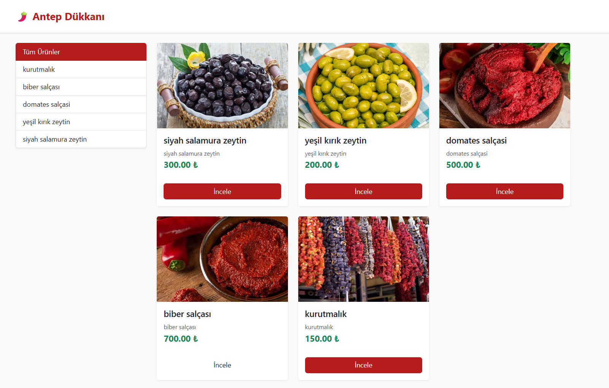
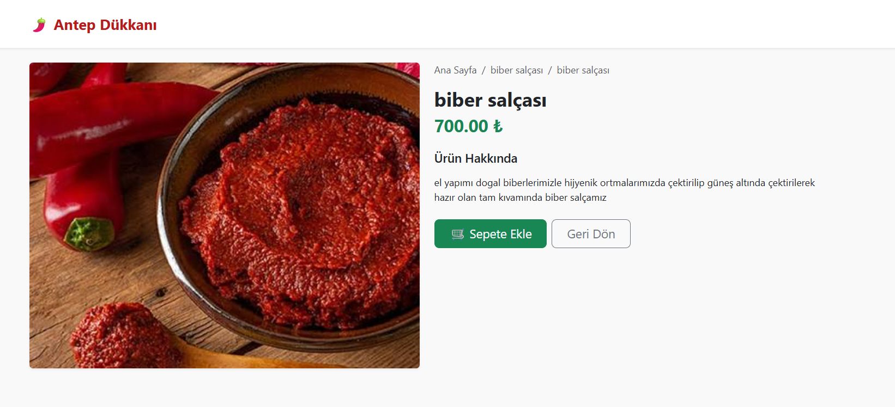

README · MD
# Antep Vitrin — Yöresel Ürünler E-Ticaret Platformu
 
Django, Bootstrap 5 ve Vanilla JavaScript (Fetch API) kullanılarak geliştirilmiş tam kapsamlı (full-stack) bir e-ticaret web uygulamasıdır. Gaziantep yöresel ürünlerinin satışı için tasarlanan sistem; üyelik zorunlu alışveriş akışı, kalıcı sepet yönetimi, atomik sipariş işleme ve anlık kargo takip özelliklerini barındırır.
 
## Öne Çıkan Özellikler
 
### Vitrin ve Katalog
 
- **Dinamik Kategori Filtreleme:** Sayfa yapısını bozmadan URL parametreleri (`/?kategori=id`) üzerinden anlık kategori filtreleme.
- **Ürün Detay Sayfaları:** Ürün görselleri, açıklamalar, fiyat bilgisi ve doğrudan sepete ekleme aksiyonları.
### Kimlik Doğrulama ve Kullanıcı Profili
 
- **Üyelik Zorunlu Alışveriş:** Sepet ve sipariş işlemleri Django `@login_required` dekoratörü ve asenkron uç noktalar için `401 Unauthorized` JSON yanıtları ile korunur.
- **Profil Yönetimi:** `User` modeline `OneToOne` ilişkiyle bağlı `Profil` modeli üzerinden kişisel bilgi güncelleme, kayıtlı teslimat adresi yönetimi ve tamamlanan ("Teslim Edildi") sipariş geçmişi.
- **Otomatik Adres Doldurma:** Profilde kayıtlı teslimat adresi, ödeme ekranında otomatik olarak forma gelir.
### Asenkron Sepet ve Modern UX
 
- **Fetch API Entegrasyonu:** Sayfa yenilenmeden (AJAX) sepete ürün ekleme ve çıkarma işlemleri.
- **Özel Bildirimler ve Modallar:** Tarayıcının varsayılan `alert`/`confirm` pencereleri yerine özel Bootstrap Toast bildirimleri ve Modal onay kutuları.
### Ödeme Simülasyonu ve Kargo Takibi
 
- **Doğrulamalı Ödeme Ekranı:** Kart numarası, son kullanma tarihi, CVV ve kart sahibi adı için anlık JavaScript formatlama/maskeleme ve HTML5 `pattern` doğrulaması.
- **Atomik Sipariş Yönetimi:** `django.db.transaction.atomic()` kullanılarak geçici sepet kalemleri kalıcı `Siparis` ve `SiparisUrunu` tablolarına aktarılır (satın alma anındaki birim fiyat dondurulur) ve ardından sepet temizlenir.
- **Kargo Durum Çubuğu:** Otomatik üretilen takip numaraları ve kargo aşamasına göre (`Hazırlanıyor` → `Kargoya Verildi` → `Dağıtıma Çıktı` → `Teslim Edildi`) güncellenen görsel ilerleme çubuğu (Progress Bar).
- **Özelleştirilmiş Admin Paneli:** Sipariş kalemlerini satır içi görüntüleme (`TabularInline`) ve liste ekranından doğrudan kargo durumu/takip no güncelleme (`list_editable`).
## Kullanılan Teknolojiler
 
- **Backend:** Python, Django (MVT Mimarisi), SQLite
- **Frontend:** HTML5, CSS3, Bootstrap 5, Vanilla JavaScript (Fetch API)
## Ekran Görüntüleri
 

 

 
## Yerel Kurulum
 
1. Repoyu klonlayın:
```bash
git clone https://github.com/Dilara297/antep-vitrin.git
cd antep-vitrin
```
 
2. Sanal ortam oluşturun ve aktif edin:
```bash
python -m venv venv
 
# Windows:
venv\Scripts\activate
 
# macOS/Linux:
source venv/bin/activate
```
 
3. Gerekli paketleri kurun:
```bash
pip install django pillow
```
 
4. Veritabanı göçlerini uygulayın ve yönetici hesabı oluşturun:
```bash
python manage.py migrate
python manage.py createsuperuser
```
 
5. Geliştirme sunucusunu başlatın:
```bash
python manage.py runserver
```
 
   Ardından tarayıcıdan `http://127.0.0.1:8000/` adresini açın. Yönetim paneli için `http://127.0.0.1:8000/admin/` adresini kullanabilirsiniz.